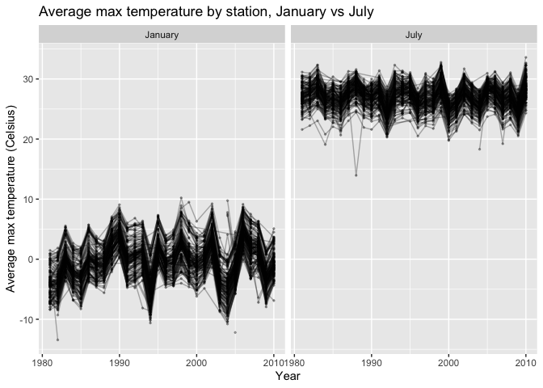
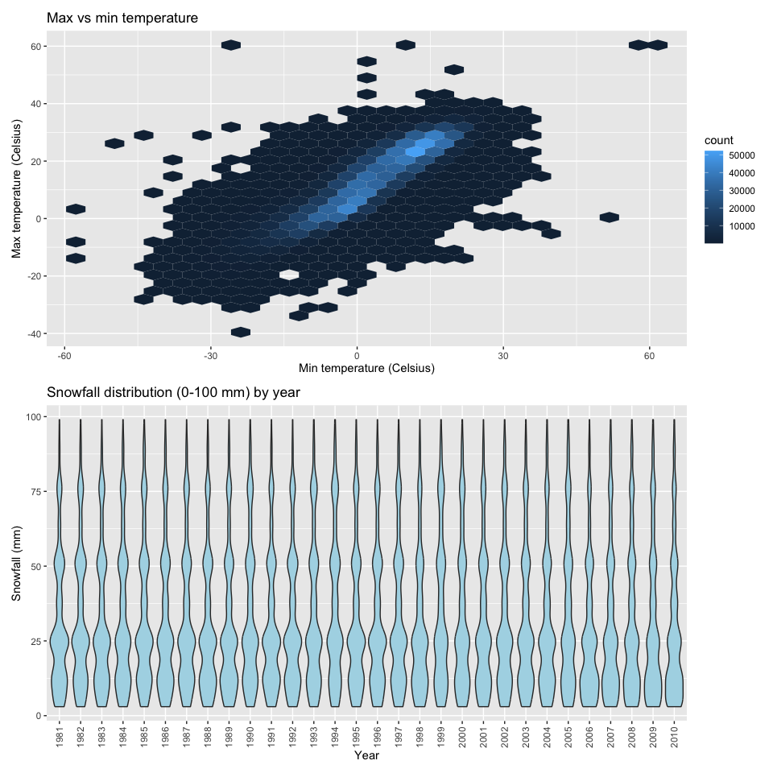
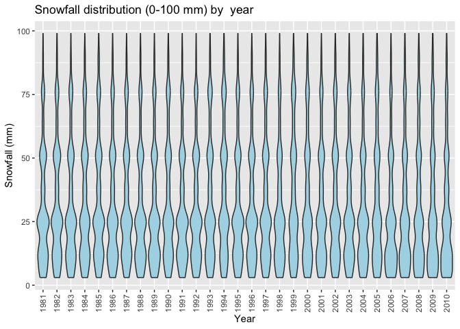
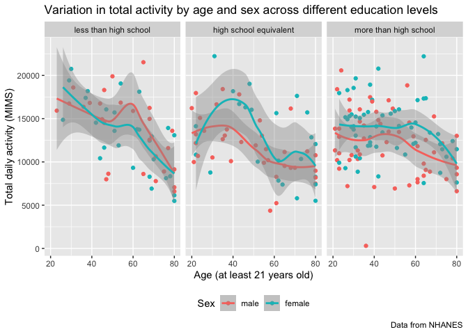
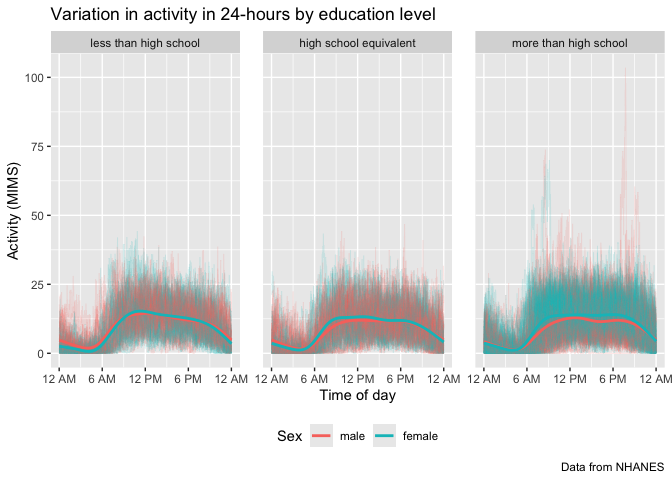
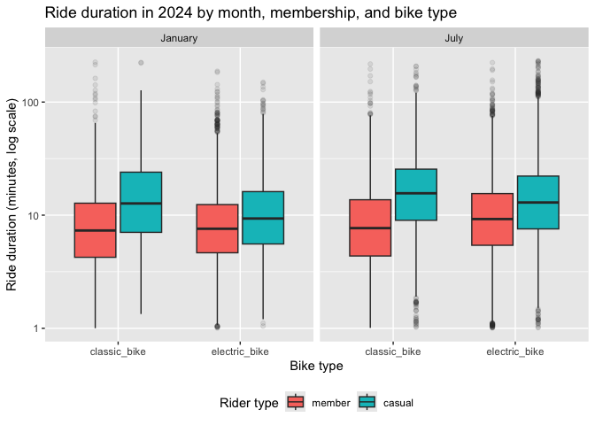

p8105_hw3_di2251
================
di2251
2026-10-14

### Problem 1

Load NY NOAA data:

``` r
library(p8105.datasets)
data("ny_noaa")

glimpse(ny_noaa)
```

    ## Rows: 2,595,176
    ## Columns: 7
    ## $ id   <chr> "US1NYAB0001", "US1NYAB0001", "US1NYAB0001", "US1NYAB0001", "US1N…
    ## $ date <date> 2007-11-01, 2007-11-02, 2007-11-03, 2007-11-04, 2007-11-05, 2007…
    ## $ prcp <int> NA, NA, NA, NA, NA, NA, NA, NA, NA, NA, NA, NA, NA, NA, NA, NA, 3…
    ## $ snow <int> NA, NA, NA, NA, NA, NA, NA, NA, NA, NA, NA, NA, NA, NA, NA, NA, 3…
    ## $ snwd <int> NA, NA, NA, NA, NA, NA, NA, NA, NA, NA, NA, NA, NA, NA, NA, NA, 0…
    ## $ tmax <chr> NA, NA, NA, NA, NA, NA, NA, NA, NA, NA, NA, NA, NA, NA, NA, NA, N…
    ## $ tmin <chr> NA, NA, NA, NA, NA, NA, NA, NA, NA, NA, NA, NA, NA, NA, NA, NA, N…

Description: size, structure, missing

``` r
ny_noaa |>
  summarise(across(everything(), ~ mean(is.na(.)))) |>
  pivot_longer(everything(), 
               names_to = "variable", 
               values_to = "prop_missing") |>
  knitr::kable(digits = 3)
```

| variable | prop_missing |
|:---------|-------------:|
| id       |        0.000 |
| date     |        0.000 |
| prcp     |        0.056 |
| snow     |        0.147 |
| snwd     |        0.228 |
| tmax     |        0.437 |
| tmin     |        0.437 |

Cleaning:

``` r
noaa_df = 
  ny_noaa |>
  mutate(
    year = lubridate::year(date),
    month = lubridate::month(date, label = TRUE, abbr = FALSE),
    day = lubridate::day(date),
    tmax = as.numeric(tmax) / 10,
    tmin = as.numeric(tmin) / 10,
    prcp = prcp / 10
  ) |>
  relocate(id, date, year, month, day)
```

Most common snowfall values:

``` r
noaa_df |>
  count(snow, sort = TRUE) |>
  head(10)
```

    ## # A tibble: 10 × 2
    ##     snow       n
    ##    <int>   <int>
    ##  1     0 2008508
    ##  2    NA  381221
    ##  3    25   31022
    ##  4    13   23095
    ##  5    51   18274
    ##  6    76   10173
    ##  7     8    9962
    ##  8     5    9748
    ##  9    38    9197
    ## 10     3    8790

``` r
noaa_df |>
  filter(month == "January" | month == "July") |>
  group_by(id, year, month) |>
  summarise(mean_tmax = mean(tmax, na.rm = TRUE), .groups = "drop") |>
  filter(!is.na(mean_tmax)) |>
  ggplot(aes(x = year, y = mean_tmax, group = id)) +
  geom_line(alpha = 0.3) +
  geom_point(alpha = 0.3, size = 0.5) +
  facet_grid(. ~ month) +
  labs(
    title = "Average max temperature by station, January vs July",
    x = "Year",
    y = "Average max temperature (Celsius)"
  )
```

<!-- -->

``` r
tmax_tmin_plot = 
  noaa_df |>
  ggplot(aes(x = tmin, y = tmax)) +
  geom_hex() +
  labs(
    title = "Max vs min temperature", 
    x = "Min temperature (Celsius)", 
    y = "Max temperature (Celsius)"
  )

snow_plot = 
  noaa_df |>
  filter(snow > 0, snow < 100) |>
  ggplot(aes(x = factor(year), y = snow)) + 
  geom_violin(fill = "lightblue") +
  labs(
    title = "Snowfall distribution (0-100 mm) by  year",
    x = "Year",
    y = "Snowfall (mm)" 
  ) +
  theme(axis.text.x = element_text(angle = 90, vjust = 0.5))

tmax_tmin_plot
```

    ## Warning: Removed 1136276 rows containing non-finite outside the scale range
    ## (`stat_binhex()`).

<!-- -->

``` r
snow_plot
```

<!-- -->

**Part A:** Do some data cleaning. Create separate variables for year,
month, and day. Ensure observations for temperature, precipitation, and
snowfall are given in reasonable units. For snowfall, what are the most
commonly observed values? Why?

**Part B:** Make a two-panel plot showing the average max temperature in
January and in July in each station across years. Is there any
observable / interpretable structure? Any outliers?

**Part C:** Make a two-panel plot showing (i) `tmax` vs `tmin` for the
full dataset (note that a scatterplot may not be the best option); and
(ii) make a plot showing the distribution of snowfall values greater
than 0 and less than 100 separately by year.

### Problem 2

**Part 1: Load, tidy, merge, and organize data sets**

Import NHANES study data and tidy raw data:

``` r
NHANES_accel <- read_csv("data/NHANES accel.csv",    
                         na = c("", "NA", "."))      

NHANES_demos <- read_csv("data/NHANES demos.csv", 
                         skip = 4,                   
                         na = c("", "NA", ".")) 

head(NHANES_accel)
```

    ## # A tibble: 6 × 1,441
    ##    SEQN  min1  min2  min3  min4   min5   min6  min7   min8    min9  min10  min11
    ##   <dbl> <dbl> <dbl> <dbl> <dbl>  <dbl>  <dbl> <dbl>  <dbl>   <dbl>  <dbl>  <dbl>
    ## 1 62161 1.11  3.12  1.47  0.938 1.60   0.145  2.10  0.509   1.63   1.20   0.947 
    ## 2 62164 1.92  1.67  2.38  0.935 2.59   5.22   2.39  4.90    1.97   3.13   2.77  
    ## 3 62169 5.85  5.18  4.76  6.48  6.85   7.24   6.12  7.48    5.47   6.49   5.14  
    ## 4 62174 5.42  3.48  3.72  3.81  6.85   4.45   0.561 1.61    0.698  2.72   4.85  
    ## 5 62177 6.14  8.06  9.99  6.60  4.57   2.78   7.10  7.25   10.1    7.49   2.72  
    ## 6 62178 0.167 0.429 0.131 1.20  0.0796 0.0487 0.106 0.0653  0.0564 0.0639 0.0909
    ## # ℹ 1,429 more variables: min12 <dbl>, min13 <dbl>, min14 <dbl>, min15 <dbl>,
    ## #   min16 <dbl>, min17 <dbl>, min18 <dbl>, min19 <dbl>, min20 <dbl>,
    ## #   min21 <dbl>, min22 <dbl>, min23 <dbl>, min24 <dbl>, min25 <dbl>,
    ## #   min26 <dbl>, min27 <dbl>, min28 <dbl>, min29 <dbl>, min30 <dbl>,
    ## #   min31 <dbl>, min32 <dbl>, min33 <dbl>, min34 <dbl>, min35 <dbl>,
    ## #   min36 <dbl>, min37 <dbl>, min38 <dbl>, min39 <dbl>, min40 <dbl>,
    ## #   min41 <dbl>, min42 <dbl>, min43 <dbl>, min44 <dbl>, min45 <dbl>, …

``` r
head(NHANES_demos)
```

    ## # A tibble: 6 × 5
    ##    SEQN   sex   age   BMI education
    ##   <dbl> <dbl> <dbl> <dbl>     <dbl>
    ## 1 62161     1    22  23.3         2
    ## 2 62164     2    44  23.2         3
    ## 3 62169     1    21  20.1         2
    ## 4 62174     1    80  33.9         3
    ## 5 62177     1    51  20.1         2
    ## 6 62178     1    80  28.5         2

Check variable types for NHANES demographic variables:

``` r
NHANES_demos |>
  count(sex, education)
```

    ## # A tibble: 8 × 3
    ##     sex education     n
    ##   <dbl>     <dbl> <int>
    ## 1     1         1    28
    ## 2     1         2    37
    ## 3     1         3    56
    ## 4     1        NA    10
    ## 5     2         1    29
    ## 6     2         2    23
    ## 7     2         3    59
    ## 8     2        NA     8

Create a demographics data frame and tidy raw data:

``` r
NHANES_demos_df = 
  read_csv("data/NHANES demos.csv", 
           skip = 4, 
           na = c("", "NA", ".")) |>
  janitor::clean_names() |>      # standardize variable name formatting
  mutate(
    sex = factor(                # assign factor labels to sex var 
      sex,
      levels = c(1, 2),
      labels = c("male", "female")
    ),
    education = factor(          # assign factor labels to education var
      education,
      levels = c(1, 2, 3),
      labels = c("less than high school", "high school equivalent", "more than high school")
    )
  ) |>
  filter("age" >= 21) |>         # exclude participants under 21 years of age
  drop_na()                      # exclude participants with missing demo data

glimpse(NHANES_demos_df)
```

    ## Rows: 229
    ## Columns: 5
    ## $ seqn      <dbl> 62161, 62164, 62169, 62174, 62177, 62178, 62180, 62184, 6218…
    ## $ sex       <fct> male, female, male, male, male, male, male, male, female, ma…
    ## $ age       <dbl> 22, 44, 21, 80, 51, 80, 35, 26, 30, 57, 36, 28, 35, 38, 62, …
    ## $ bmi       <dbl> 23.3, 23.2, 20.1, 33.9, 20.1, 28.5, 27.9, 22.1, 22.4, 28.0, …
    ## $ education <fct> high school equivalent, more than high school, high school e…

Clean variable names:

``` r
NHANES_accel = janitor::clean_names(NHANES_accel)

head(NHANES_accel)
```

    ## # A tibble: 6 × 1,441
    ##    seqn  min1  min2  min3  min4   min5   min6  min7   min8    min9  min10  min11
    ##   <dbl> <dbl> <dbl> <dbl> <dbl>  <dbl>  <dbl> <dbl>  <dbl>   <dbl>  <dbl>  <dbl>
    ## 1 62161 1.11  3.12  1.47  0.938 1.60   0.145  2.10  0.509   1.63   1.20   0.947 
    ## 2 62164 1.92  1.67  2.38  0.935 2.59   5.22   2.39  4.90    1.97   3.13   2.77  
    ## 3 62169 5.85  5.18  4.76  6.48  6.85   7.24   6.12  7.48    5.47   6.49   5.14  
    ## 4 62174 5.42  3.48  3.72  3.81  6.85   4.45   0.561 1.61    0.698  2.72   4.85  
    ## 5 62177 6.14  8.06  9.99  6.60  4.57   2.78   7.10  7.25   10.1    7.49   2.72  
    ## 6 62178 0.167 0.429 0.131 1.20  0.0796 0.0487 0.106 0.0653  0.0564 0.0639 0.0909
    ## # ℹ 1,429 more variables: min12 <dbl>, min13 <dbl>, min14 <dbl>, min15 <dbl>,
    ## #   min16 <dbl>, min17 <dbl>, min18 <dbl>, min19 <dbl>, min20 <dbl>,
    ## #   min21 <dbl>, min22 <dbl>, min23 <dbl>, min24 <dbl>, min25 <dbl>,
    ## #   min26 <dbl>, min27 <dbl>, min28 <dbl>, min29 <dbl>, min30 <dbl>,
    ## #   min31 <dbl>, min32 <dbl>, min33 <dbl>, min34 <dbl>, min35 <dbl>,
    ## #   min36 <dbl>, min37 <dbl>, min38 <dbl>, min39 <dbl>, min40 <dbl>,
    ## #   min41 <dbl>, min42 <dbl>, min43 <dbl>, min44 <dbl>, min45 <dbl>, …

``` r
NHANES_df = left_join(NHANES_demos_df, NHANES_accel, by = "seqn")

head(NHANES_df)
```

    ## # A tibble: 6 × 1,445
    ##    seqn sex      age   bmi education  min1  min2  min3  min4   min5   min6  min7
    ##   <dbl> <fct>  <dbl> <dbl> <fct>     <dbl> <dbl> <dbl> <dbl>  <dbl>  <dbl> <dbl>
    ## 1 62161 male      22  23.3 high sch… 1.11  3.12  1.47  0.938 1.60   0.145  2.10 
    ## 2 62164 female    44  23.2 more tha… 1.92  1.67  2.38  0.935 2.59   5.22   2.39 
    ## 3 62169 male      21  20.1 high sch… 5.85  5.18  4.76  6.48  6.85   7.24   6.12 
    ## 4 62174 male      80  33.9 more tha… 5.42  3.48  3.72  3.81  6.85   4.45   0.561
    ## 5 62177 male      51  20.1 high sch… 6.14  8.06  9.99  6.60  4.57   2.78   7.10 
    ## 6 62178 male      80  28.5 high sch… 0.167 0.429 0.131 1.20  0.0796 0.0487 0.106
    ## # ℹ 1,433 more variables: min8 <dbl>, min9 <dbl>, min10 <dbl>, min11 <dbl>,
    ## #   min12 <dbl>, min13 <dbl>, min14 <dbl>, min15 <dbl>, min16 <dbl>,
    ## #   min17 <dbl>, min18 <dbl>, min19 <dbl>, min20 <dbl>, min21 <dbl>,
    ## #   min22 <dbl>, min23 <dbl>, min24 <dbl>, min25 <dbl>, min26 <dbl>,
    ## #   min27 <dbl>, min28 <dbl>, min29 <dbl>, min30 <dbl>, min31 <dbl>,
    ## #   min32 <dbl>, min33 <dbl>, min34 <dbl>, min35 <dbl>, min36 <dbl>,
    ## #   min37 <dbl>, min38 <dbl>, min39 <dbl>, min40 <dbl>, min41 <dbl>, …

**Part 2: Table and age distribution plot**

``` r
NHANES_df |>
  count(sex, education) |>
  pivot_wider(
    names_from = sex,
    values_from = n
  ) |>
  knitr::kable()
```

| education              | male | female |
|:-----------------------|-----:|-------:|
| less than high school  |   27 |     28 |
| high school equivalent |   36 |     23 |
| more than high school  |   56 |     59 |

**Part 3: Total activity vs. age**

Aggregate across minutes to create a total activity variable:

``` r
NHANES_df = NHANES_df |>
  mutate(total_activity = rowSums(pick(starts_with("min"))))
```

Plot total activities (y-axis) against age (x-axis)

``` r
NHANES_df |>
  ggplot(aes(x = age, y = total_activity, color = sex)) +
  geom_point() +
  geom_smooth() +
  labs(
    title = "Variation in total activity by age and sex across different education levels",
    x = "Age (at least 21 years old)", 
    y = "Total daily activity (MIMS)",
    color = "Sex",
    caption = "Data from NHANES"
  ) +
  facet_grid(. ~ education) +
  theme(legend.position = "bottom")
```

<!-- -->

**Part 4: 24-hour activity time course**

``` r
NHANES_long = NHANES_df |>
  pivot_longer(
    cols = starts_with("min"),
    names_to = "minute",
    values_to = "mims",
    names_prefix = "min",
    names_transform = list(minute = as.numeric)
  )
```

``` r
NHANES_long |>
  ggplot(aes(x = minute, y = mims, color = sex)) +
  geom_line(aes(group = seqn), alpha = .15, linewidth = .3) +
  geom_smooth(se = FALSE, linewidth = 1) +
  labs(
    title = "Variation in activity in 24-hours by education level",
    x = "Time of day",
    y = "Activity (MIMS)",
    color = "Sex",
    caption = "Data from NHANES"
  ) +
  scale_x_continuous(
    breaks = c(0, 360, 720, 1080, 1440),
    labels = c("12 AM", "6 AM", "12 PM", "6 PM", "12 AM" )
  ) +
  facet_grid(. ~ education) +
  theme(legend.position = "bottom", panel.spacing = unit(1.2, "lines"))
```

<!-- -->

### Problem 3

**Part 1: Import, clean, and tidy data sets**

Import NYC Citi Bike data:

``` r
Jan2020_citi <- read_csv("data/citibike/Jan 2020 Citi.csv",
                         na = c("", "NA", "."))

Jan2024_citi <- read_csv("data/citibike/Jan 2024 Citi.csv",
                         na = c("", "NA", "."))

Jul2020_citi <- read_csv("data/citibike/July 2020 Citi.csv",
                         na = c("", "NA", "."))

Jul2024_citi <- read_csv("data/citibike/July 2024 Citi.csv",
                         na = c("", "NA", "."))
```

Label:

``` r
citi_df = 
  bind_rows(
    list(
      "January_2020" = Jan2020_citi,
      "January_2024" = Jan2024_citi,
      "July_2020" = Jul2020_citi,
      "July_2024" = Jul2024_citi
    ),
    .id = "source"
  ) |>
  janitor::clean_names() |>
  separate(source, into = c("month", "year"), sep = "_") |>
  mutate(
    year = as.integer(year),
    month = factor(month, levels = c("January", "July"))
  ) |>
  relocate(year, month)

glimpse(citi_df)
```

    ## Rows: 99,485
    ## Columns: 9
    ## $ year               <int> 2020, 2020, 2020, 2020, 2020, 2020, 2020, 2020, 202…
    ## $ month              <fct> January, January, January, January, January, Januar…
    ## $ ride_id            <chr> "4BE06CB33B037044", "26886E034974493B", "24DC56060E…
    ## $ rideable_type      <chr> "classic_bike", "classic_bike", "classic_bike", "cl…
    ## $ weekdays           <chr> "Tuesday", "Wednesday", "Friday", "Sunday", "Friday…
    ## $ duration           <dbl> 15.333267, 5.309467, 9.691800, 6.996183, 2.849500, …
    ## $ start_station_name <chr> "Columbus Ave & W 95 St", "2 Ave & E 96 St", "Colum…
    ## $ end_station_name   <chr> "E 53 St & Madison Ave", "1 Ave & E 110 St", "Grand…
    ## $ member_casual      <chr> "member", "member", "member", "member", "member", "…

Label:

``` r
citi_df = citi_df |>
  mutate(
    weekdays = factor(weekdays, levels = c("Monday", "Tuesday", "Wednesday", "Thursday", "Friday", "Saturday", "Sunday")),
    rideable_type = factor(rideable_type),
    member_casual = factor(member_casual, levels = c("member", "casual"))
  )

glimpse(citi_df)
```

    ## Rows: 99,485
    ## Columns: 9
    ## $ year               <int> 2020, 2020, 2020, 2020, 2020, 2020, 2020, 2020, 202…
    ## $ month              <fct> January, January, January, January, January, Januar…
    ## $ ride_id            <chr> "4BE06CB33B037044", "26886E034974493B", "24DC56060E…
    ## $ rideable_type      <fct> classic_bike, classic_bike, classic_bike, classic_b…
    ## $ weekdays           <fct> Tuesday, Wednesday, Friday, Sunday, Friday, Sunday,…
    ## $ duration           <dbl> 15.333267, 5.309467, 9.691800, 6.996183, 2.849500, …
    ## $ start_station_name <chr> "Columbus Ave & W 95 St", "2 Ave & E 96 St", "Colum…
    ## $ end_station_name   <chr> "E 53 St & Madison Ave", "1 Ave & E 110 St", "Grand…
    ## $ member_casual      <fct> member, member, member, member, member, member, mem…

**Part 2: Rides by year, month, and membership**

Create a table for rides by year, month, and membership:

``` r
citi_df |>
  count(year, month, member_casual) |>
  pivot_wider(names_from = member_casual, values_from = n) |>
  knitr::kable(col.names = c("Year", "Month", "Members", "Casual riders"))
```

| Year | Month   | Members | Casual riders |
|-----:|:--------|--------:|--------------:|
| 2020 | January |   11436 |           984 |
| 2020 | July    |   15411 |          5637 |
| 2024 | January |   16753 |          2108 |
| 2024 | July    |   36262 |         10894 |

**Part 3: Top 5 starting stations, July 2024**

Create a table showing the 5 most popular starting stations for July
2024:

``` r
citi_df |>
  filter(year == 2024, month == "July") |>
  count(start_station_name, sort = TRUE, name = "rides") |>
  slice_head(n = 5) |>
  knitr::kable(col.names = c("Starting station", "Number of rides"))
```

| Starting station         | Number of rides |
|:-------------------------|----------------:|
| Pier 61 at Chelsea Piers |             163 |
| University Pl & E 14 St  |             155 |
| W 21 St & 6 Ave          |             152 |
| West St & Chambers St    |             150 |
| W 31 St & 7 Ave          |             146 |

**Part 4: Median duration by day, month, and year**

Create a plot on the effects of the day of the week, month, and year on
median ride duration:

``` r
citi_df |>
  group_by(year, month, weekdays) |>
  summarize(median_duration = median(duration), .groups = "drop") |>
  ggplot(aes(x = weekdays, y = median_duration, color = month, group = month)) + 
  geom_point() +
  geom_line() +
  facet_grid(. ~ year) + 
  labs(
    title = "Median ride duration by day of week week, month, and year",
    x = "Day of week",
    y = "Median ride duration (minutes)",
    color = "Month"
  ) + 
  theme(axis.text.x = element_text(angle = 45, hjust = 1),
        legend.position = "bottom")
```

<!-- -->

**Part 5: 2024 duration distribution by month, membership, and bike
type**

Impact of month, membership status, and bike type, on the distribution
of ride duration for data in 2024:

``` r
citi_df |>
  filter(year == 2024) |>
  ggplot(aes(x = rideable_type, y = duration, fill = member_casual)) +
  geom_boxplot(outlier.alpha = .1) +
  scale_y_log10() +
  facet_grid(. ~ month) + 
  labs(
    title = "Ride duration in 2024 by month, membership, and bike type",
    x = "Bike type",
    y = "Ride duration (minutes, log scale)",
    fill = "Rider type"
  ) +
  theme(legend.position = "bottom")
```

<!-- -->
