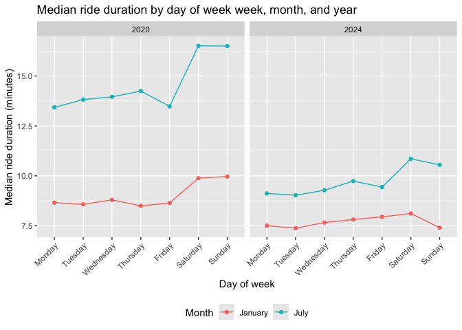

p8105_hw3_di2251
================
di2251
2026-10-14

### Problem 1

Load NY NOAA data:

``` r
library(p8105.datasets)
data("ny_noaa")

view(ny_noaa)
```

Short description of dataset (size & structure, key variables, missing
data, etc.):

**Part A:** Do some data cleaning. Create separate variables for year,
month, and day. Ensure observations for temperature, precipitation, and
snowfall are given in reasonable units. For snowfall, what are the most
commonly observed values? Why?

**Part B:** Make a two-panel plot showing the average max temperature in
January and in July in each station across years. Is there any
observable / interpretable structure? Any outliers?

**Part C:** Make a two-panel plot showing (i) `tmax` vs `tmin` for the
full dataset (note that a scatterplot may not be the best option); and
(ii) make a plot showing the distribution of snowfall values greater
than 0 and less than 100 separately by year.

### Problem 2

Import NHANES study data and conduct a preliminary clean:

``` r
NHANES_accel <- read_csv("data/NHANES accel.csv",    # import raw data
                         na = c("", "NA", "."))      # unify NA coding
```

    ## Rows: 250 Columns: 1441
    ## ── Column specification ────────────────────────────────────────────────────────
    ## Delimiter: ","
    ## dbl (1441): SEQN, min1, min2, min3, min4, min5, min6, min7, min8, min9, min1...
    ## 
    ## ℹ Use `spec()` to retrieve the full column specification for this data.
    ## ℹ Specify the column types or set `show_col_types = FALSE` to quiet this message.

``` r
NHANES_demos <- read_csv("data/NHANES demos.csv", 
                         skip = 4,                   # skip rows without data
                         na = c("", "NA", ".")) 
```

    ## Rows: 250 Columns: 5
    ## ── Column specification ────────────────────────────────────────────────────────
    ## Delimiter: ","
    ## dbl (5): SEQN, sex, age, BMI, education
    ## 
    ## ℹ Use `spec()` to retrieve the full column specification for this data.
    ## ℹ Specify the column types or set `show_col_types = FALSE` to quiet this message.

``` r
view(NHANES_accel)                                   # view preliminary data
view(NHANES_demos)
```

Check variable outputs for NHANES demographics:

``` r
NHANES_demos |>
  count(sex, education)
```

    ## # A tibble: 8 × 3
    ##     sex education     n
    ##   <dbl>     <dbl> <int>
    ## 1     1         1    28
    ## 2     1         2    37
    ## 3     1         3    56
    ## 4     1        NA    10
    ## 5     2         1    29
    ## 6     2         2    23
    ## 7     2         3    59
    ## 8     2        NA     8

Create a demographics dataframe and tidy raw data:

``` r
NHANES_demos_df = 
  read_csv("data/NHANES demos.csv", 
           skip = 4, 
           na = c("", "NA", ".")) |>
  janitor::clean_names() |>      # standardize variable name formatting
  mutate(
    sex = factor(                # assign factor labels to sex var 
      sex,
      levels = c(1, 2),
      labels = c("male", "female")
    ),
    education = factor(          # assign factor labels to education var
      education,
      levels = c(1, 2, 3),
      labels = c("less than high school", "high school equivalent", "more than high school")
    )
  ) |>
  filter("age" >= 21) |>         # exclude participants under 21 years of age
  drop_na()                      # exclude participants with missing demo data
```

    ## Rows: 250 Columns: 5
    ## ── Column specification ────────────────────────────────────────────────────────
    ## Delimiter: ","
    ## dbl (5): SEQN, sex, age, BMI, education
    ## 
    ## ℹ Use `spec()` to retrieve the full column specification for this data.
    ## ℹ Specify the column types or set `show_col_types = FALSE` to quiet this message.

``` r
view(NHANES_demos_df)
```

``` r
NHANES_accel = janitor::clean_names(NHANES_accel)

view(NHANES_accel)
```

``` r
NHANES_df = left_join(NHANES_demos_df, NHANES_accel, by = "seqn")

view(NHANES_df)
```

``` r
NHANES_df |>
  count(sex, education) |>
  pivot_wider(
    names_from = sex,
    values_from = n
  ) |>
  knitr::kable()
```

| education              | male | female |
|:-----------------------|-----:|-------:|
| less than high school  |   27 |     28 |
| high school equivalent |   36 |     23 |
| more than high school  |   56 |     59 |

Aggregate across minutes to create a total activity variable:

``` r
NHANES_df = NHANES_df |>
  mutate(total_activity = rowSums(pick(starts_with("min"))))
```

Plot total activities (y-axis) against age (x-axis)

``` r
NHANES_df |>
  ggplot(aes(x = age, y = total_activity, color = sex)) +
  geom_point() +
  geom_smooth() +
  labs(
    title = "Variation in total activity by age and sex across different education levels",
    x = "Age (at least 21 years old)", 
    y = "Total daily activity (MIMS)",
    color = "Sex",
    caption = "Data from NHANES"
  ) +
  facet_grid(. ~ education) +
  theme(legend.position = "bottom")
```

    ## `geom_smooth()` using method = 'loess' and formula = 'y ~ x'

<!-- -->

``` r
NHANES_long = NHANES_df |>
  pivot_longer(
    cols = starts_with("min"),
    names_to = "minute",
    values_to = "mims",
    names_prefix = "min",
    names_transform = list(minute = as.numeric)
  )
```

``` r
NHANES_long |>
  ggplot(aes(x = minute, y = mims, color = sex)) +
  geom_line(aes(group = seqn), alpha = .15, linewidth = .3) +
  geom_smooth(linewidth = 1) +
  labs(
    title = "Variation in activity in 24-hours by education level",
    x = "Time of day",
    y = "Activity (MIMS)",
    color = "Sex",
    caption = "Data from NHANES"
  ) +
  scale_x_continuous(
    breaks = c(0, 360, 720, 1080, 1440),
    labels = c("12 AM", "6 AM", "12 PM", "6 PM", "12 AM" )
  ) +
  facet_grid(. ~ education) +
  theme(legend.position = "bottom", panel.spacing = unit(1.2, "lines"))
```

    ## `geom_smooth()` using method = 'gam' and formula = 'y ~ s(x, bs = "cs")'

<!-- -->

### Problem 3
